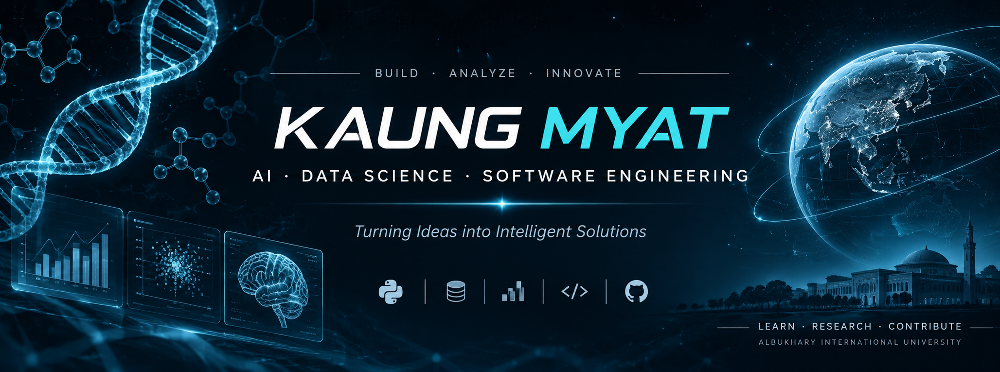

---

# KAUNG MYAT

### Computer Science Student | Data Science | AI & Research

I build software, explore intelligent systems, and apply data-driven approaches to real-world challenges.

---

## ABOUT ME

I'm a Computer Science undergraduate specializing in Data Science at Albukhary International University, Malaysia.

My interests include:

- Artificial Intelligence & Machine Learning
- Data Science & Computational Research
- Bioinformatics & Genomics
- Software Engineering
- Technology for Social Impact

## CURRENT FOCUS

- Developing machine learning projects.
- Exploring computational biology and genomics.
- Building practical software applications.
- Participating in international research and innovation challenges.

## TECHNOLOGIES & TOOLS

## SELECTED PROJECTS

| Project | Focus |
|---|---|
| WEHI DataCommon | Research Data Analysis |
| CRIM | Web Application Development |
| REMIT | FinTech & Intelligent Systems |
| Protinus | Software Development |
| PhytoLensAI | Computational Research |

## GITHUB STATISTICS

---

### BUILDING · LEARNING · RESEARCHING

*Interested in international research collaboration, scientific innovation, and meaningful technology.*

